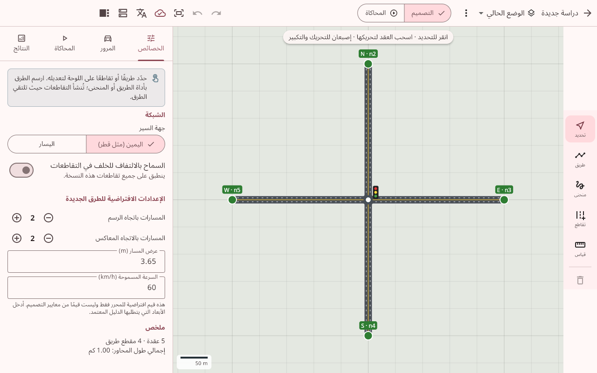
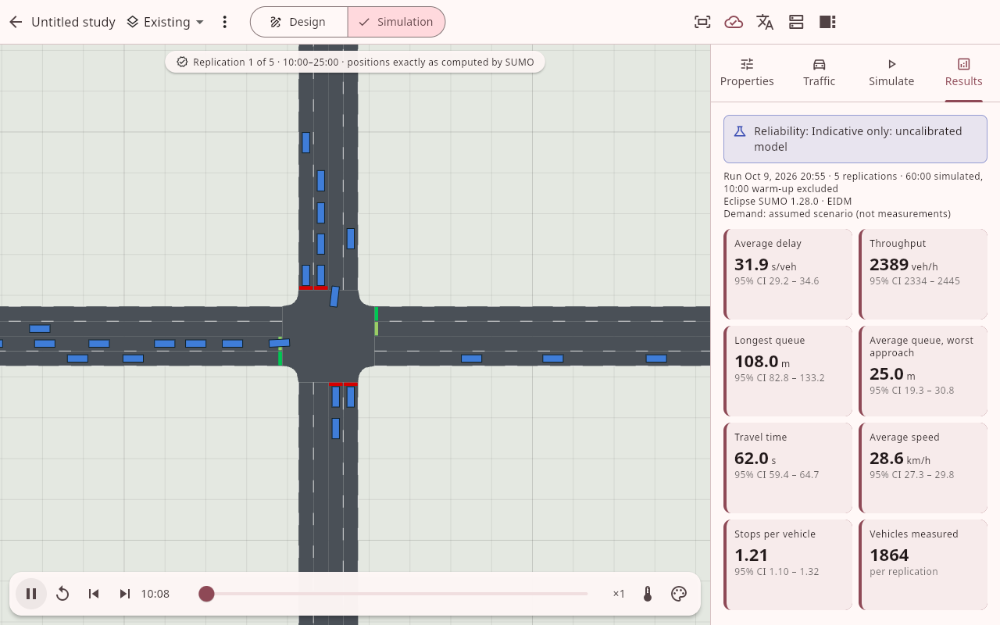
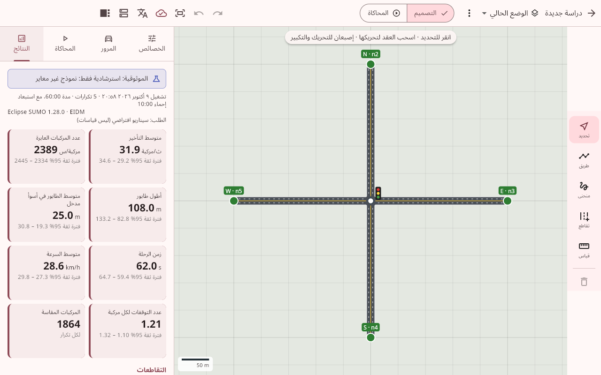
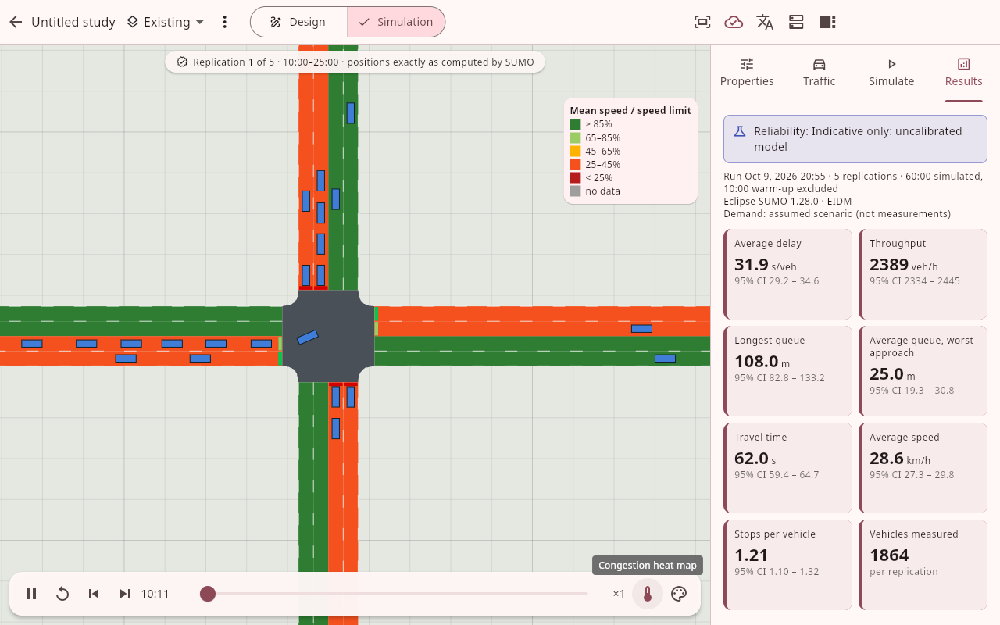

# RoadFlow AI

**تطبيق هندسي للأجهزة اللوحية لتصميم الطرق والتقاطعات واختبار انسيابيتها بمحاكاة مرورية مجهرية حقيقية (SUMO).**
**A tablet engineering app for designing roads and junctions and testing them with real microscopic traffic simulation (SUMO).**

[العربية](#العربية) · [English](#english)

| التصميم (عربي) | المحاكاة – حركة المركبات كما حسبها SUMO |
|---|---|
|  |  |
| **النتائج مع فترات الثقة** | **خريطة الازدحام الحرارية** |
|  |  |

---

## العربية

### ما الذي يعمل الآن (المرحلة الأولى)
- **محرر طرق ثنائي الأبعاد** باللمس والقلم:
  - رسم طرق مستقيمة ومنحنية.
  - ضبط اتجاه السير وعدد المسارات وعرضها والسرعة المسموحة.
  - إنشاء التقاطعات آليًا عند التقاء الطرق، أو من قوالب (رباعي، ثلاثي، دوار).
  - جيوب انعطاف بطول تخزين يُقاس حتى خط التوقف.
  - دوارات متعددة المسارات، وتقاطعات بإشارات أو توقف أو إفساح طريق.
  - تقاطع منفصل المستوى (جسر/نفق دون تقاطع)، ومناسيب للعقد.
  - أدوات قياس الطول والزاوية والمساحة، وتراجع/إعادة، ومحاذاة للشبكة.
- **الطلب المروري:**
  - حجم الحركة لكل مدخل، وتركيبة المركبات، ونسب الانعطاف لكل وجهة.
  - تمييز صريح بين **الأعداد المرصودة** و**السيناريو الافتراضي**، يظهر حتى في النتائج.
- **محاكاة مجهرية حقيقية** على الخادم بمحرك SUMO:
  - نموذج تتبع EIDM (امتداد IDM) مع تنوع السائقين في زمن الاستجابة والفاصل الزمني والتسارع.
  - تغيير المسارات وقبول الفجوات.
  - شاحنات وحافلات، وإشارات بزمن ثابت.
  - عدة تكرارات ببذور عشوائية.
- **النتائج:**
  - متوسط التأخير، وزمن الرحلة، والسرعة، وعدد المركبات العابرة، وأطوال الطوابير (المتوسط والمئين 95 والأقصى)، وعدد التوقفات.
  - النتائج لكل مدخل ولكل تقاطع، مع **فترة ثقة 95%** ومستوى خدمة **استرشادي** وفق حدود HCM.
  - تحذيرات جودة البيانات والافتراضات المستخدمة، وتصدير CSV.
- **عرض المحاكاة:** حركة كل مركبة كما حسبها SUMO مع حالة الإشارات وخريطة ازدحام حرارية، وتشغيل وإيقاف وتسريع وانتقال لأي لحظة ومتابعة مركبة.
- **إدارة المشاريع:**
  - حفظ تلقائي آمن على الجهاز، والعمل دون اتصال في التصميم.
  - نسخ تصميم متعددة لكل مشروع (الوضع الحالي / البدائل).
- واجهة عربية كاملة من اليمين لليسار مع إمكانية التحويل للإنجليزية، ووضع أفقي.

### مبادئ الدقة
- لا تُعرض أي أرقام افتراضية على أنها نتائج؛ كل رقم ناتج عن تشغيل المحاكاة.
- النموذج **غير معاير** ببيانات ميدانية بعد، والنتائج **استرشادية**، وهذا ظاهر في كل شاشة نتائج.
- جرى التحقق من الإعدادات الافتراضية مقابل معادلة Webster ومعادلات الطاقة الاستيعابية في HCM الإصدار السادس. انظر [VALIDATION.md](docs/VALIDATION.md). أدت هذه الاختبارات إلى تصحيح قيم SUMO الافتراضية التي كانت تعطي 15–30% فقط من الطاقة الاستيعابية المرجعية.
- لا توجد قيم تنظيمية لقطر (أشغال/QHDM) مفترضة؛ ستُدعم عند توفير الأدلة الرسمية.

### التشغيل السريع
1. **خادم المحاكاة** (Linux/macOS، Python ≥ 3.11):
   ```bash
   cd server
   pip install -r requirements.txt
   uvicorn roadflow_server.main:app --host 0.0.0.0 --port 8000
   # أو: docker build -t roadflow-server server && docker run -p 8000:8000 roadflow-server
   ```
   لتفعيل الحماية: `ROADFLOW_API_TOKEN=...`. وفي بيئة الإنتاج ضع الخادم خلف HTTPS.
2. **التطبيق:**
   - **أندرويد:** نزّل ملف APK من مخرجات GitHub Actions (CI)، أو ابنِه بالأمر `cd app && flutter build apk`.
   - **iPad:** يتطلب جهاز Mac مع Xcode وحسابًا للتوقيع، ثم الأمر `flutter build ios`.
3. في التطبيق: أيقونة الخادم ← أدخل عنوان الخادم (مثل `http://192.168.1.10:8000`) ← اختبار الاتصال.
4. مشروع جديد ← قالب «تقاطع رباعي بإشارات» ← تبويب المحاكاة ← «محاكاة» ← النتائج ← وضع «المحاكاة» للمشاهدة.

### الوثائق
- [البنية التقنية](docs/ARCHITECTURE.md)
- [منهجية المحاكاة وتعريف المؤشرات](docs/SIMULATION_METHODOLOGY.md)
- [التحقق والدقة](docs/VALIDATION.md)
- [واجهة الخادم البرمجية](docs/API.md)
- [خارطة الطريق وحالة كل ميزة](docs/ROADMAP.md)

---

## English

### What works today (phase 1)
- **2D road editor** for touch and pen:
  - straight and freehand-curved roads
  - one-way / two-way, lanes per direction, lane width, speed limits
  - automatic junctions where roads meet or cross, plus 4-arm / T / roundabout templates
  - left and right turn bays (storage measured to the stop line)
  - multi-lane roundabouts; signal, stop, give-way and all-way-stop control
  - grade-separated crossings and node elevations
  - measuring tool (length, angle, area), undo/redo, grid and snapping
- **Traffic demand:**
  - flow per entry, vehicle mix (car/truck/bus) and destination (turning) shares
  - data **provenance** (observed vs assumed) carried through to the results
- **Real microscopic simulation** with SUMO on the server:
  - EIDM car following with heterogeneous drivers (reaction time, headway, acceleration, speed choice)
  - lane changing and gap acceptance
  - trucks and buses, fixed-time signals
  - seeded replications
- **Results:**
  - average delay, travel time, speed, throughput, queue lengths (mean / 95th percentile / max), stops
  - per approach and per junction, with **95 % confidence intervals** and **indicative** HCM-threshold LOS
  - data-quality warnings, the assumptions used, CSV export
- **Playback:** of SUMO's own vehicle positions and signal states, with a congestion
  heat map, speed colouring, seek, ×0.25–×16 speed and vehicle following.
- **Projects:**
  - stored on the device with crash-safe autosave; design works offline
  - multiple design variants per project
- Full Arabic RTL UI with an English toggle; landscape tablet layout.

### Accuracy principles
- No placeholder numbers: every figure comes from a simulation run.
- The model is **not calibrated** to field data yet, so results are labelled
  **indicative** everywhere.
- The defaults were benchmarked against Webster and HCM 6th Ed. capacity relations; see
  [VALIDATION.md](docs/VALIDATION.md). This found and fixed SUMO defaults that gave only
  15–30 % of reference capacities at unsignalised junctions.
- No Qatar regulatory values (Ashghal / QHDM) are assumed; they will be supported once
  the official documents are provided.

### Quick start
1. **Simulation server** (Linux/macOS, Python ≥ 3.11):
   ```bash
   cd server
   pip install -r requirements.txt
   uvicorn roadflow_server.main:app --host 0.0.0.0 --port 8000
   # or: docker build -t roadflow-server server && docker run -p 8000:8000 roadflow-server
   ```
   Set `ROADFLOW_API_TOKEN` to require a token, and serve over HTTPS in production.
2. **App:**
   - **Android tablets:** download the APK artifact from the GitHub Actions CI run, or
     build it with `cd app && flutter build apk`.
   - **iPad:** needs a Mac with Xcode and a signing team, then `flutter build ios`.
3. In the app: server icon → enter the server address (e.g. `http://192.168.1.10:8000`)
   → Test connection.
4. New project → "4-arm signalised intersection" → Simulate tab → Simulate → Results →
   Simulation mode to watch.

### Development
```bash
cd server && pip install -r requirements-dev.txt && pytest -q   # 43 tests incl. SUMO runs and benchmarks
cd app && flutter test && flutter analyze                        # 35 tests (geometry, editing, contract, widgets)
# End-to-end in a browser (Flutter web build + Playwright):
cd app && flutter build web --no-web-resources-cdn && (cd build/web && python3 -m http.server 8080) &
npm install playwright && node e2e/web_flow.mjs en   # writes screenshots to the current directory
```

### Repository layout
| Path | Content |
|---|---|
| `app/` | Flutter tablet app (Android, iPadOS; web build used for automated E2E tests) |
| `server/` | FastAPI + SUMO simulation server, tests, benchmarks, Dockerfile |
| `shared/fixtures/` | JSON request fixtures validated by both sides |
| `docs/` | Architecture, methodology, validation, API, roadmap |
| `e2e/` | Browser end-to-end script |

### Licences of third-party components
- Eclipse SUMO: EPL-2.0.
- Noto Sans and Noto Sans Arabic fonts: SIL OFL 1.1 (`app/assets/fonts/OFL.txt`).
- HCM and Webster are cited for benchmark relationships only.
